# Bedrock to Redrock — Martian Map

<div align="center">

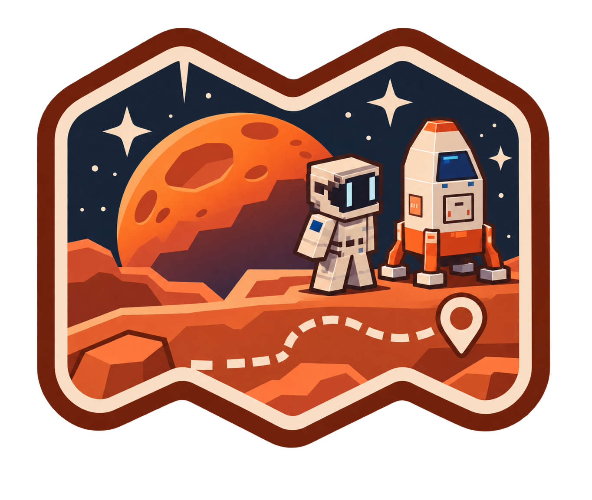

### An Interplanetary Survival Guide & Interactive Terrain Navigation System for Mars

[](https://www.spaceappschallenge.org/2026/find-a-team/bedrock-to-redrock/)
[](https://b-2-r.us)
[](tests/)
[](https://www.typescriptlang.org/)
[](https://react.dev/)
[](https://threejs.org/)

**[Explore the Live App](https://b-2-r.us)** · **[NASA Space Apps Team Page](https://www.spaceappschallenge.org/2026/find-a-team/bedrock-to-redrock/)** · **[Architecture Guide](docs/architecture/marswalk-app.md)** · **[Deployment & Running](docs/release/RUNNING.md)**

</div>

---

## The NASA Space Apps Challenge

Developed for the **NASA Space Apps Challenge 2026** at the **Irbid, Jordan** local event, **Bedrock to Redrock** directly solves the **"Interplanetary Survival Guide: Martian Map"** challenge.

Future crewed expeditions to the Red Planet will demand far more than static imagery or simple two-dimensional route lines. On an unforgiving alien surface where every slope consumes vital oxygen, every cliff poses communication blackouts, and every detour risks rover battery reserves, human explorers and autonomous ground systems require **context-rich, terrain-aware, and mission-tested navigation intelligence**.

### The Core Problem
1. **Extreme Terrain Hazards:** Martian topography features vertical crater scarps, deep sand traps, and boulder fields that make straight-line travel fatal.
2. **Disconnected Science Data:** Planetary datasets (MOLA elevation rasters, HiRISE high-resolution orbital imagery, rover waypoint logs, Mars24 sun coordinates) exist in isolated repositories with complex formats.
3. **Sensor-to-Reality Gap:** Astronauts on Earth need intuitive ways to train and experience Martian traverses before setting foot on the surface.

---

## What We Accomplished

**Bedrock to Redrock** transforms authentic NASA scientific data into an intuitive, responsive, and offline-capable 3D/2D planetary navigation suite. Inspired by the discovery and survival dynamics of *Minecraft*, our system empowers both scientists on Earth and future explorers on Mars to visualize, evaluate, simulate, and walk actual Martian routes.

```
+----------------------------------------------------------------------------------------------------+
|                                    BEDROCK TO REDROCK SUITE                                        |
+------------------------------------+----------------------------------+----------------------------+
| 3D Globe & 2D Planetary Navigator  | Multi-Criteria Terrain Router    | Earth-to-Mars Walk GPS     |
| * Full MOLA global elevation grid  | * Slope-penalized A* algorithm   | * Real-time GPS mapping    |
| * Viking color basemap & ice caps  | * Downhill/uphill energy model   | * Turn-by-turn voice audio |
| * 54+ verified historic sites      | * 3 distinct routes compared     | * 1:1 up to 100,000x scale |
| * Mars24 prime meridian & sun clock| * Science target stops & returns | * Web push notifications   |
+------------------------------------+----------------------------------+----------------------------+
| Interactive 3D Drone Aerial Recon  | High-Res Regional Workspaces     | Offline PWA Architecture   |
| * Autonomous low-altitude flights  | * 1m/pixel Jezero (Wildcat Ridge)| * Service Worker offline   |
| * Dynamic camera pitch & orbit     | * 20m/pixel Gale (Mount Sharp)   | * Embedded GeoTIFF engine  |
| * Waypoint science flag framing    | * Geological layer overlays      | * Zero external CDNs       |
+------------------------------------+----------------------------------+----------------------------+
```

---

## Feature Showcase & Screenshots

### 1. Dual-Engine Planetary Navigation (3D Sphere & 2D Projection)
Seamlessly transition between a photorealistic 3D Mars globe with authentic axial tilt, atmospheric scattering, and polar cap mapping, and a flat equirectangular projection equipped with smooth panning, coordinate clamping, and marker clustering.

| 3D Interactive Mars Globe | Simultaneous 2D/3D Rover Science & Routes |
| :---: | :---: |
| 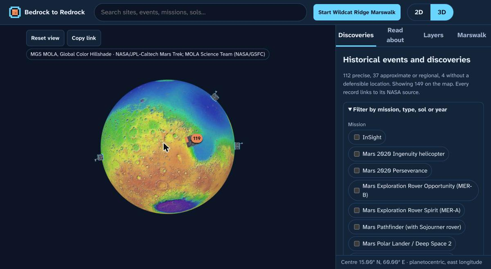 | 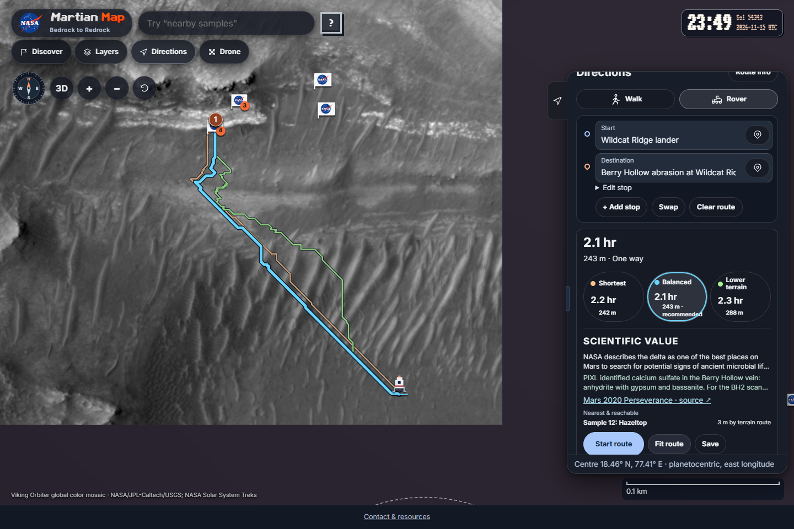 |
| *Global elevation terrain rendered with MOLA data* | *Simultaneous pathfinding with rover science flags* |

---

### 2. Multi-Criteria Terrain Routing Engine
Traditional pathfinders calculate flat Euclidean distance. Our solver incorporates a physics-grounded terrain cost function:
* **Asymmetric Slope Penalties:** Steep ascents penalize speed and oxygen expenditure heavily; controlled descents carry half the penalty of uphill climb.
* **Cliff & Barrier Exclusion:** Elevation gradients exceeding rover/EVA safety thresholds (e.g. $>25^\circ$) are strictly prohibited.
* **Three Route Strategies Evaluated Simultaneously:**
  1. <span style="color:#f97316">**Shortest Path (Orange):**</span> Minimum ground distance, navigating around sheer cliffs.
  2. <span style="color:#06b6d4">**Balanced Route (Cyan):**</span> Optimized trade-off between elevation change and total distance.
  3. <span style="color:#10b981">**Lowest Slope (Green):**</span> Gentlest gradient profile to protect rover hardware and EVA suits.

| Synchronized Multi-Route Comparison | Turn-by-Turn Audio & Directional Guidance |
| :---: | :---: |
| 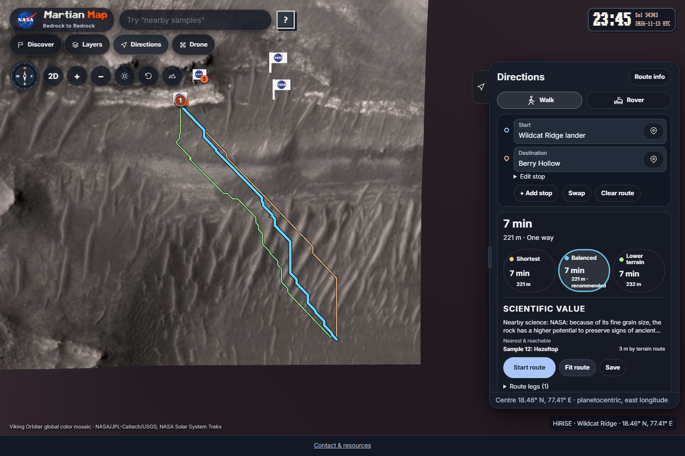 | 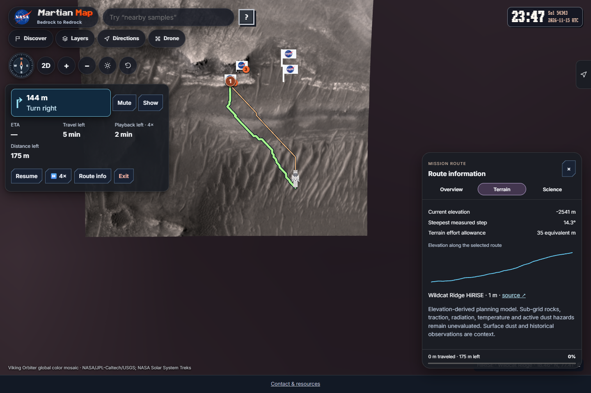 |
| *3 selectable routing profiles with elevation profiles* | *Next-maneuver arrows, distance remaining, and voice cues* |

---

### 3. Aerial Reconnaissance: 3D Drone Flyover Mode
Experience high-altitude and low-altitude reconnaissance over challenging terrain. Switch into third-person drone camera mode to preview the selected route from above, orbit active science targets, and inspect geological formations before dispatching ground crew.

| Wildcat Ridge Drone Reconnaissance | Mount Sharp / Gale Crater Drone Flight |
| :---: | :---: |
| 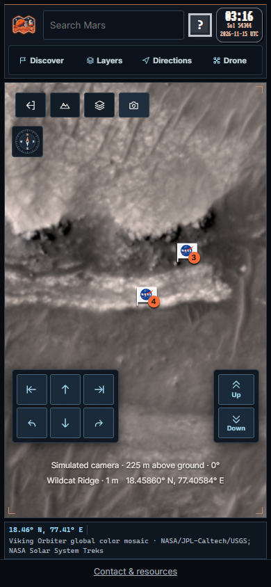 | 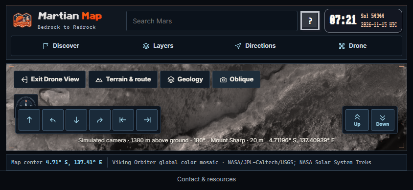 |
| *Jezero Crater 1m/px HiRISE photogrammetry* | *Gale Crater Mount Sharp geological ascent* |

---

### 4. Earth-to-Mars Walk GPS & PWA Experience
Test Marswalk routes in the real world using physical phone GPS sensors:
* **Interactive Scales:** Step outdoors on Earth and map your physical walk directly onto Martian coordinates:
  * `1:1` Local EVA Simulation (1m Earth = 1m Mars).
  * `1000×` Regional Traverse (1m Earth = 1km Mars).
  * `10,000×` and `100,000×` Planetwide Expeditions across the Martian equator.
* **Audio Guidance:** Real-time spoken instructions, audio chimes for waypoints, compass course corrections, and slope warnings.
* **Off-Route Detection:** Automatic detection of route deviation with proactive replanning or backtrack guidance.
* **Live Martian Solar Clock:** Computes authentic Coordinated Mars Time (MTC), local solar time, and subsolar noon.

| Mobile Next-Step Navigation | Real-Time Mars Solar Clocks |
| :---: | :---: |
| 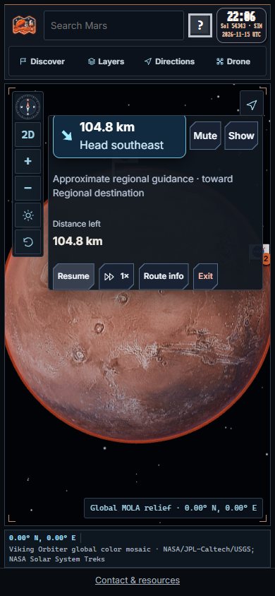 | 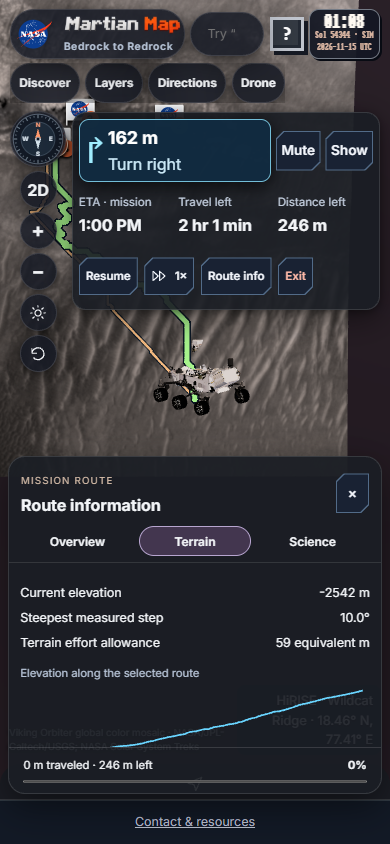 |
| *Pocket-sized EVA guidance with tactile compass* | *High-precision MTC & Sol synchronization* |

---

## Authentic NASA Data Integration

Every map coordinate, elevation sample, and science waypoint in **Bedrock to Redrock** is grounded in verified NASA planetary mission records:

| Mission / Instrument | Dataset Used | Application in Project |
| :--- | :--- | :--- |
| **Mars Global Surveyor (MOLA)** | 1/16° Global Elevation Grid | Planetary 3D topography and global routing |
| **Mars Reconnaissance Orbiter (HiRISE)** | High-Resolution DTMs (1m/pixel) | Wildcat Ridge & Jezero Crater local terrain |
| **Mars Express (HRSC)** | Regional Digital Terrain Models (20m/pixel) | Gale Crater & Mount Sharp geological routing |
| **Viking Orbiter 1 & 2** | MDIM 2.1 Color Basemap Mosaic | True-color surface albedo basemap |
| **Mars 2020 (Perseverance)** | Navcam, Mastcam-Z & Watson imagery | In-situ ground truth photos and sample depot pins |
| **Mars Science Lab (Curiosity)** | Mastcam & ChemCam science logs | Gediz Vallis sulfur crystal discoveries |
| **Mars24 Sun Clock Algorithm** | NASA GISS Solar Equations | MTC, Sol duration, and subsolar point calculation |

<details>
<summary><strong>View NASA Discovery Images Embedded in the Project</strong></summary>

<br />

| Perseverance at Wildcat Ridge | Berry Hollow Abrasion (WATSON) |
| :---: | :---: |
| 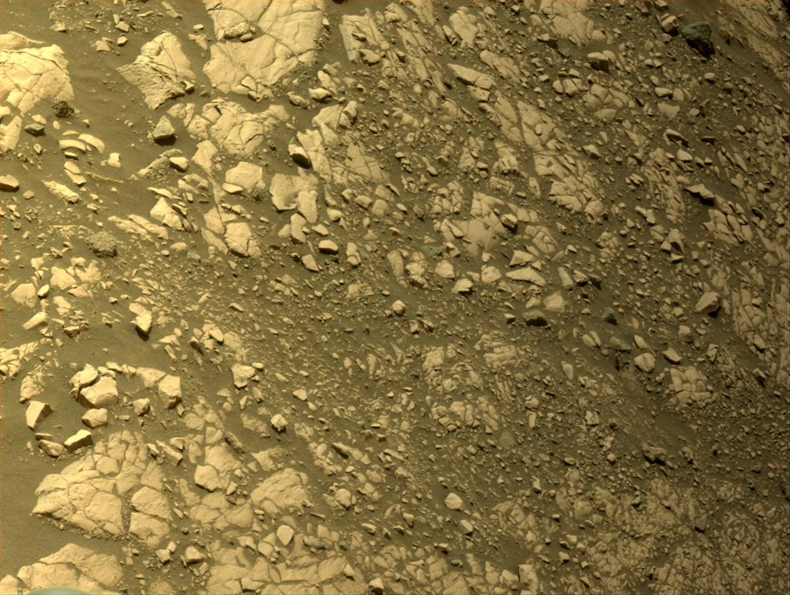 | 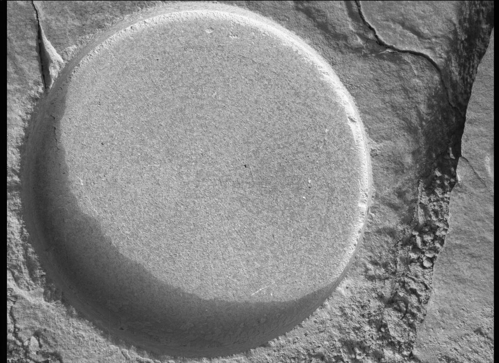 |
| *Sol 502 Navcam panoramic view* | *Sol 504 microscopic rock abrasion* |

| Three Forks Sample Depot | Ingenuity Images Perseverance Backshell |
| :---: | :---: |
| 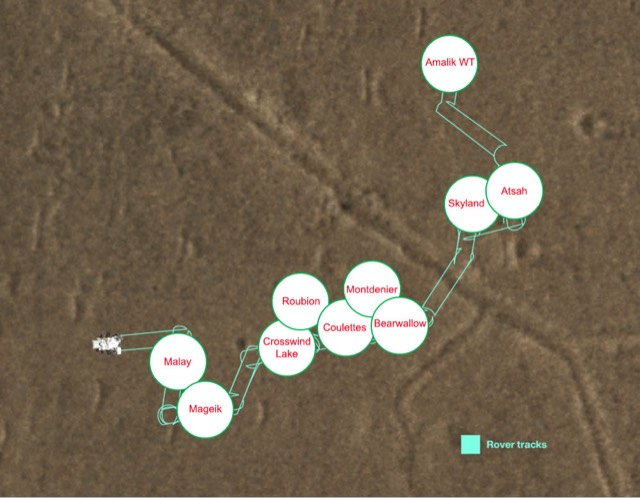 |  |
| *First sample depot on another world* | *Aerial inspection from Ingenuity flight* |

</details>

---

## Architecture & Technology Stack

The application is engineered as a modern, high-performance, and offline-first Progressive Web App (PWA):

```
                        +---------------------------------------------+
                        |             React 19 UI Layer               |
                        | (LiveHome, Explorer, Directions, EarthWalk) |
                        +----------------------+----------------------+
                                               |
                     +-------------------------+-------------------------+
                     |                                                   |
        +------------v------------+                         +------------v------------+
        |   Three.js 3D Engine    |                         |  2D Canvas / WebGL Map  |
        | * 3D Globe with MOLA    |                         | * Equirectangular pan   |
        | * HiRISE Terrain Meshes |                         | * Clustered markers     |
        | * Animated Drone Flyover|                         | * Vector route overlays |
        +------------+------------+                         +------------+------------+
                     |                                                   |
                     +-------------------------+-------------------------+
                                               |
                        +----------------------v----------------------+
                        |         Routing & Physics Workers           |
                        | * Deterministic A* Terrain Pathfinding      |
                        | * Web Worker thread isolation               |
                        | * LERC & GeoTIFF fast raster decoding       |
                        +----------------------+----------------------+
                                               |
                        +----------------------v----------------------+
                        |         Hardware & Audio Integrations       |
                        | * Web Audio API (Spatialized chimes)        |
                        | * Geolocation API (1:1 & scaled walks)      |
                        | * Service Worker (Offline asset cache)      |
                        +---------------------------------------------+
```

* **Core Framework:** React 19, TypeScript 7, Vite 8.
* **3D Visualization:** Three.js (0.187) with custom shaders, orbit controls, and GLTF/GLB models.
* **Raster Decoders:** GeoTIFF, Zstandard, LERC, Pako (DEFLATE).
* **Audio Synthesis & Voice:** Web Audio API with synthesized frequency chimes and SpeechSynthesis turn announcements.
* **Edge Hosting:** Cloudflare Pages with globally distributed Edge Functions.

---

## Getting Started

### Prerequisites
* **Node.js:** `^22.18.0` or `>=24.0.0`
* **npm:** `>=10.0.0`
* **Python:** `>=3.10` (for map layer verification)

### Installation & Local Run

```bash
# 1. Clone the repository
git clone https://github.com/Hadisovic/Nasa-Bedrock-to-redrock-martian-map.git
cd Nasa-Bedrock-to-redrock-martian-map

# 2. Install dependencies
npm ci

# 3. Start development server
npm run dev
# The app opens at http://localhost:5173
# Explore routes: /#/explore, /#/map, /#/bench

# 4. Run automated test suite
npm test

# 5. Build for production
npm run build
```

### Verification Scripts
To validate that all planetary data layers, MOLA elevation grids, and manifest checksums conform to mission criteria:
```bash
python scripts/data/layers/validate.py .
```

---

## Test Suite & Quality Assurance

Our test-driven architecture ensures mathematical fidelity and cross-device stability across 60 automated tests:
* **Contract Tests:** Verified A* Dijkstra equivalence, directional elevation penalty consistency, MOLA elevation bounds, and seam-crossing math.
* **GPS & Navigation:** Accelerometer step detection debouncing, GPS jitter filtering, scale transformations, and deviation thresholds.
* **Mission Timing:** NASA Mars24 prime meridian alignment and subsolar noon tracking.

```
✔ A* costs match an independent Dijkstra reference on random grids
✔ direction-dependent costs: downhill counts half the penalty of uphill
✔ real Wildcat Ridge route: speed changes time and margin, not distance
✔ 1000× GPS demo maps a metre east and north to a kilometre on Mars
✔ planetwide demo scales map across the Mars longitude seam
✔ ordered preview instructions follow the current leg and respect coarse coverage
✔ nearby rover landmarks use sourced coordinates and follow the active leg
✔ Mars24 prime meridian matches NASA's worked example and noon follows subsolar point
✔ global routes cross the longitude seam by the short edge
✔ bundled MOLA data supports finite routes outside Jezero and near the pole
-------------------------------------------------------------------------------------
ℹ tests 60 | pass 60 | fail 0 | 100% Passing
```

---

## Live Links & Resources

* **Live Web Application:** [https://b-2-r.us](https://b-2-r.us)
* **Cloudflare Pages Mirror:** [https://b2r-5f4.pages.dev](https://b2r-5f4.pages.dev)
* **Official NASA Space Apps Page:** [Team Bedrock to Redrock](https://www.spaceappschallenge.org/2026/find-a-team/bedrock-to-redrock/)
* **Local Event:** Irbid, Jordan — NASA Space Apps Challenge 2026

---

<div align="center">

*Bedrock to Redrock — From building worlds to exploring new ones.*

</div>
