<div align="center">

# Bedrock to Redrock

**Explore Mars. Plan a surface mission. Rehearse the route.**

Martian Map · NASA Space Apps Challenge 2026 · Irbid, Jordan

[Open the live app](https://b-2-r.us/) · [Explore Mars](https://b-2-r.us/#/explore) · [Try a Marswalk](https://b-2-r.us/#/map?tab=mission) · [Meet the team](https://www.spaceappschallenge.org/2026/find-a-team/bedrock-to-redrock/)

</div>

[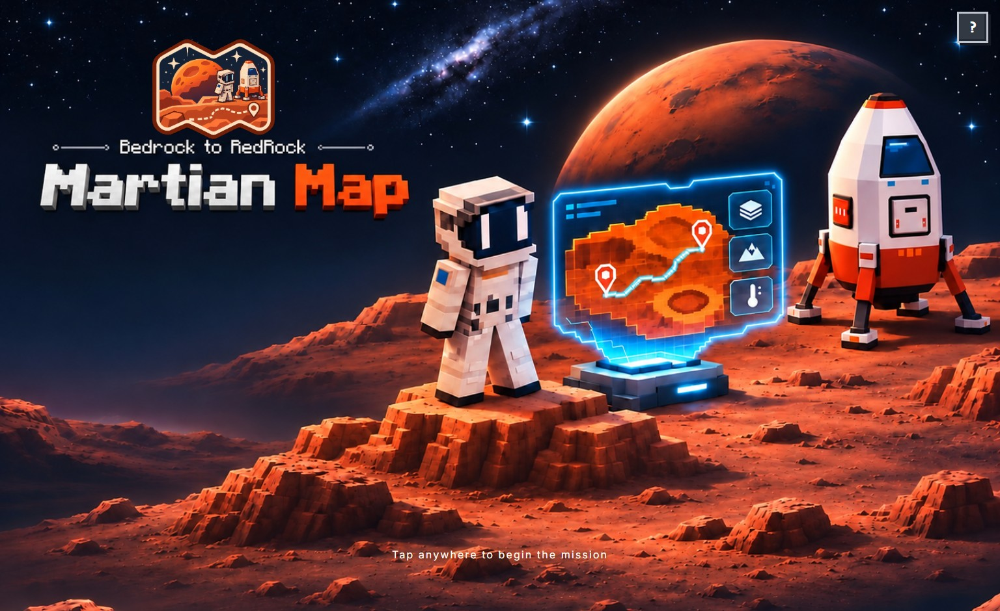](https://b-2-r.us/)

Bedrock to Redrock brings mission imagery, measured terrain, and documented rover discoveries into one map. Choose a science stop, compare paths from a lander, and see how travel and science time affect your return reserve. Then follow the route as an astronaut or rover.

Built for [Interplanetary Survival Guide: Martian Map](https://www.spaceappschallenge.org/2026/challenges/interplanetary-survival-guide-martian-map/?tab=details), the project combines data from multiple missions to help an explorer plan and rehearse a Marswalk. The screenshots below were captured from the live app.

## Start a mission

1. **Find a destination.** Open **Discover**, search for Berry Hollow, and read what Perseverance found at Wildcat Ridge.
2. **Plan the trip.** In **Directions**, place the lander and add science stops. Compare routes, then open **Route details** to inspect terrain, travel time, and return reserve.
3. **Rehearse.** Select **Start route** and choose an astronaut or rover preview. On a supported phone or tablet, **Earth GPS Demo** uses your movement to drive the simulated position. Try the [GPS demo routes](docs/release/GPS-DEMO-ROUTES.md) for exact coordinates, replanning, and sourced alerts.

## Explore the map

- Switch between a **full-Mars 2D map and a 3D globe** with natural-color Viking imagery. Use the compass, zoom, reset view, and 3D solar lighting. The clock shows local solar time at the map center and the current sol.
- Search **21 map data entries**, including basemaps and the numerical elevation grid. Toggle overlays for terrain, geology, minerals, water and ice indicators, dust, and thermal properties. Each layer includes its source, coverage, legend, and opacity control where applicable.
- Show or hide discovery flags and drone coverage. The map works with mouse, keyboard, and touch, with collapsible desktop and mobile panels and an optional in-app tutorial.

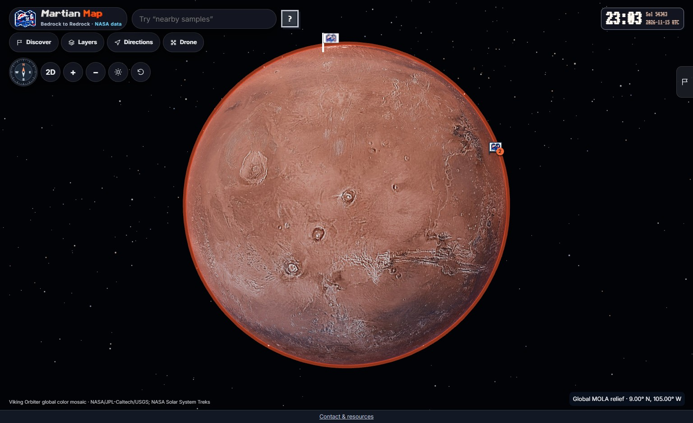

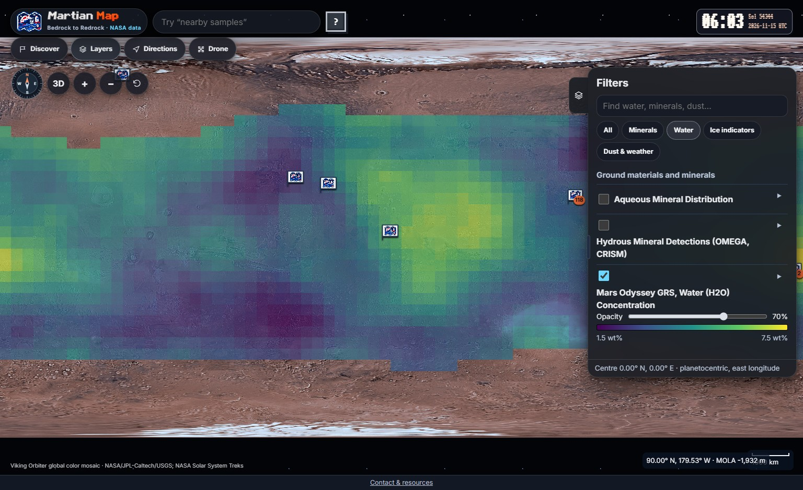

## Discover real science

Search **149 mapped records** for landings, rover stops, samples, and mission hardware. Open **Read about** from a flag or search result for observations, credited rover photos where available, source links, and position uncertainty. **Go to location** centers the map, and a science flag can become an itinerary stop.

At **Berry Hollow** in Jezero Crater, Perseverance studied minerals in an abrasion patch at Wildcat Ridge. The mission also collected the nearby **Hazeltop** and **Bearwallow** cores from ancient lake sediment. [NASA’s Wildcat Ridge sample story](https://science.nasa.gov/resource/meet-the-mars-samples-hazeltop-and-bearwallow-samples-12-and-13/) · [Bundled event catalog](data/mars/catalog/events.json)

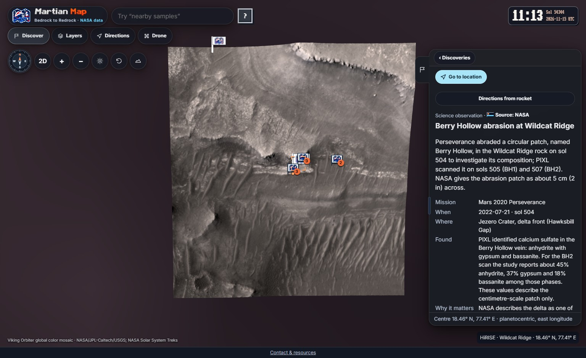

## Plan with Directions

- **Build an itinerary.** Select a lander and up to 12 ordered stops from the map, search, or discovery flags. Add, replace, reorder, or remove stops, set science time for each, and choose a one-way trip or a return to the lander.
- **Compare routes.** Choose **Shortest** or **Lower slope cost** when both are available. The solver uses the selected terrain grid and slope limit for each leg. You can report a blocked cell or inspect a nearby point when the local solver finds a reachable alternative. If a leg fails, successfully solved legs stay visible.
- **Inspect the terrain.** See outbound and dashed return lines, distance, elevation profile, ascent and descent, steepest measured slope, and each leg’s source and resolution.
- **Make a return decision.** Compare walking and rover estimates. Set departure, speed, science time, mission budget, and reserve. The app calculates arrival, daylight, and the return margin for supported plans. The [Wildcat Ridge rehearsal](https://b-2-r.us/#/map?tab=mission) includes a baseline, a changed-conditions example, and a blocked-route case.

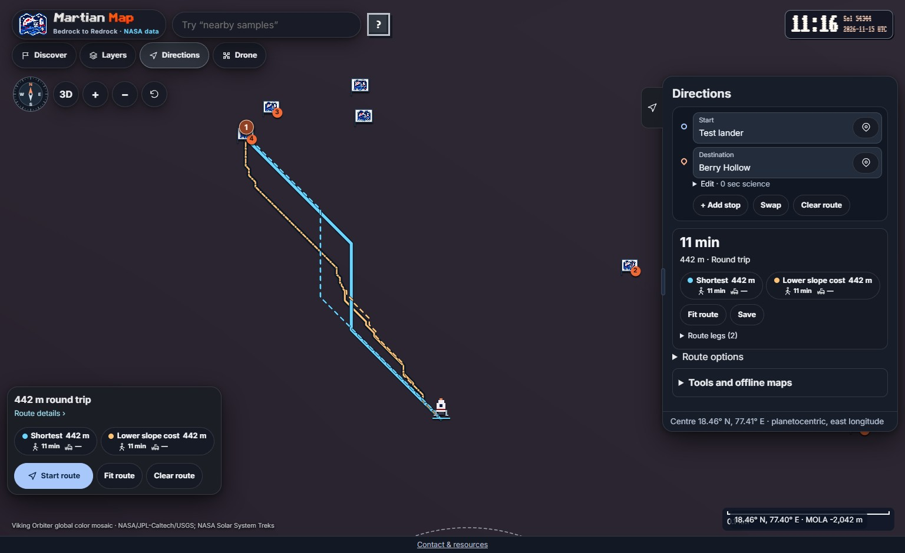

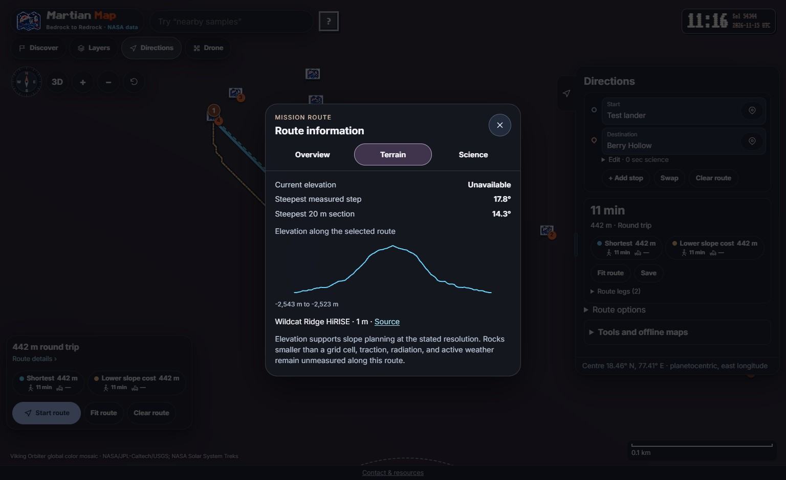

## Rehearse with navigation

- **Recorded preview** follows the calculated path with a blocky astronaut or a 3D Perseverance model. The navigation card shows numbered steps, turn arrows, remaining distance, compass bearings, and estimated arrival. Voice cues advance with playback. Pause, recenter, mute, or repeat a cue as needed.
- **Earth GPS Demo** uses the first reliable phone or tablet fix as the lander origin. It maps real movement onto simulated Mars travel at a selectable scale. Optional device tilt controls the camera and compass. Earth coordinates stay on the device. On detailed terrain, sustained deviation can trigger replanning through the remaining stops. If the solver cannot verify a detour, guidance gives the distance and bearing back to the route.
- **Mission Control alerts** can announce nearby documented discoveries, terrain warnings, and dated observations. Supported device notifications can show the last confirmed instruction when switching away. Fresh location and voice guidance resume with the map open. [GPS and notification setup](docs/release/RUNNING.md#earth-gps-notifications)

<div align="center">
  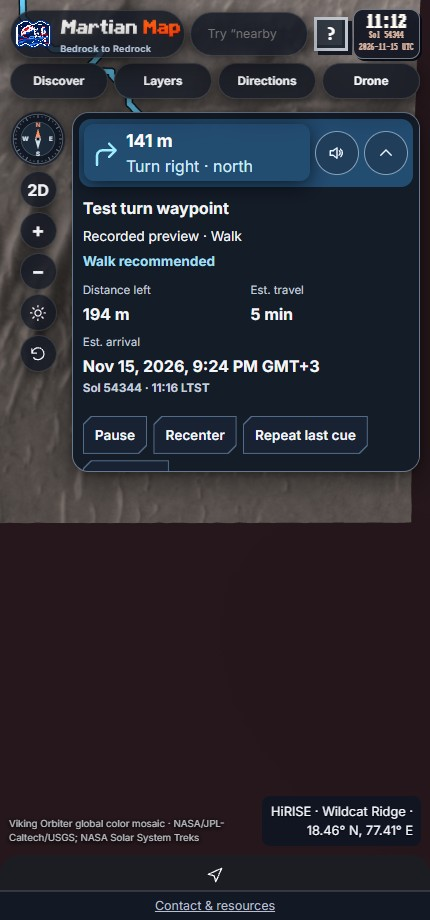
</div>

## Fly the terrain

Choose **Drone** to fly over **Wildcat Ridge at 1 m** or **Gale Crater · Mount Sharp at 20 m**. Steer with the direction pad, adjust altitude, pan or zoom the camera, and toggle the sourced geology overlay. **Terrain & route** lets you place the animated lander, add stops from the ground or science flags, and preview a calculated astronaut or rover route while controlling the camera. [NASA’s Mount Sharp flyover](https://science.nasa.gov/resource/curiositys-proposed-path-up-mount-sharp/)

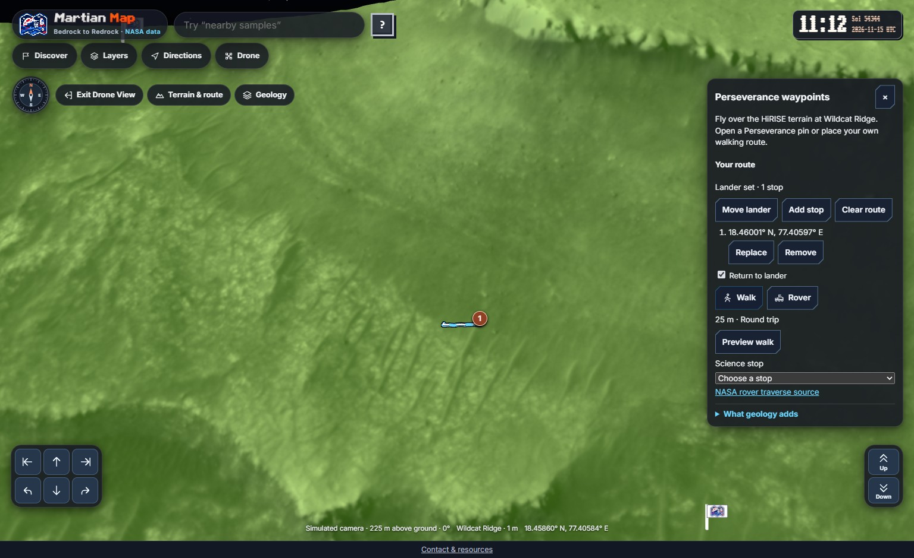

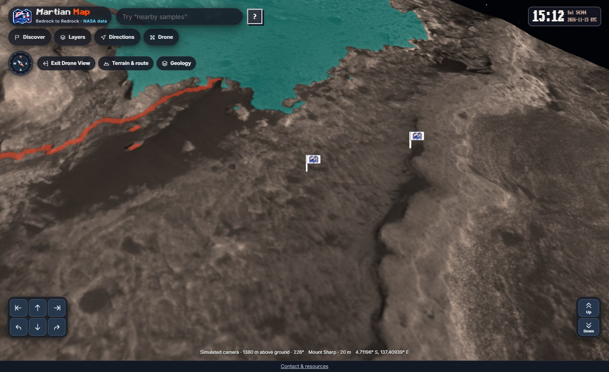

## Save, share, and use offline

- Name, reopen, edit, duplicate, or delete multiple plans saved in the browser.
- Share a versioned route link or export a route file with the stops, selected path, and planning assumptions.
- Download the planet map and either terrain pack before going offline. Saved routes and bundled voice cues are available with the appropriate pack. Fine online tiles and external source pages need a connection.

## Data and references

- **Planetwide imagery and terrain** use [NASA JPL Mars Trek](https://trek.nasa.gov/mars/) and [Mars Global Surveyor MOLA](https://pds-geosciences.wustl.edu/missions/mgs/mola.html). The [map data inventory](data/mars/layers/manifest.json) records sources and coverage for individual layers.
- **Wildcat Ridge elevation and imagery** use the USGS Mars 2020 [HiRISE terrain model](https://www.usgs.gov/data/mars-2020-terrain-relative-navigation-hirise-dtm-mosaic) and [orthorectified imagery](https://data.usgs.gov/datacatalog/data/USGS%3A13c20ddb-2a2c-4bbd-bac4-3ef88cd0eabf).
- **Geology** draws on [USGS mapping of Jezero Crater](https://doi.org/10.3133/sim3464) and [orbital mapping of lower Mount Sharp](https://doi.org/10.1130/GSAB.S.25938268). See the [terrain pack notes](docs/release/RUNNING.md) for processing and attribution.
- **Rover evidence** comes from [NASA’s Perseverance sample catalog](https://science.nasa.gov/mission/mars-2020-perseverance/mars-rock-samples/), [raw image gallery](https://mars.nasa.gov/mars2020/multimedia/raw-images/), [Curiosity traverse records](https://mars.nasa.gov/mmgis-maps/MSL/Layers/json/MSL_traverse.json), and the sources linked on each discovery card. The 3D rover uses the [NASA/JPL-Caltech model](https://science.nasa.gov/resource/mars-perseverance-rover-3d-model/).
- **Time and solar position** follow the [NASA GISS Mars24 algorithm and worked examples](https://www.giss.nasa.gov/tools/mars24/help/algorithm.html).

**Coverage and limits.** Detailed routing uses two terrain packs. The global MOLA grid provides regional estimates at roughly 14.8 km spacing near the equator. Route estimates cover the inputs and terrain shown in the app. Fine obstacles, traction, live weather, radiation, and suit consumables require further data and modeling. Earth GPS positions and drone flights are simulations.

<details>
<summary>Rover and mission image gallery</summary>

- **Perseverance at Wildcat Ridge** · Navcam view. Credit NASA/JPL-Caltech.

  

- **Berry Hollow abrasion** · WATSON view of the patch studied by PIXL. Credit NASA/JPL-Caltech.

  

- **Hazeltop and Bearwallow** · Wildcat Ridge sample site. Credit NASA/JPL-Caltech/ASU/MSSS.

  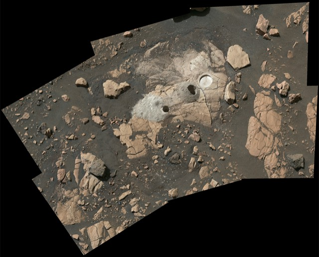

- **Three Forks sample depot** · NASA’s marked sample locations. Credit NASA/JPL-Caltech.

  

- **Perseverance landing hardware** · Backshell and parachute imaged by Ingenuity. Credit NASA/JPL-Caltech.

  

- **Sulfur at Gediz Vallis** · Curiosity found yellow sulfur crystals in a rock it broke open. Credit NASA/JPL-Caltech/MSSS.

  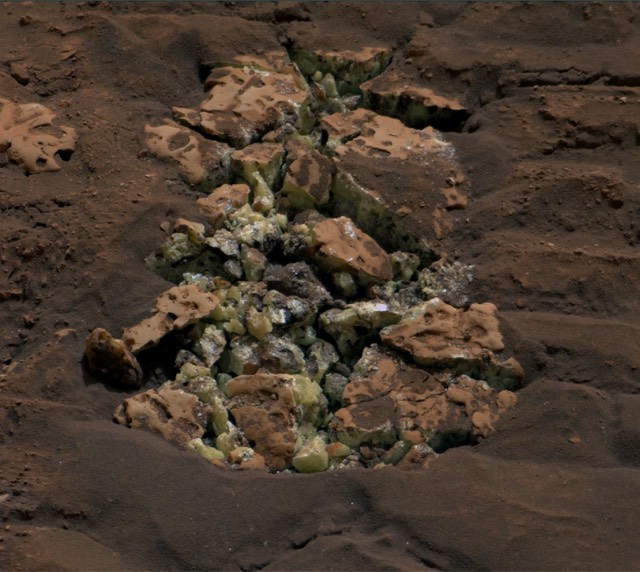

- **Spirit at Troy** · Orbital image of the rover’s last position. Credit NASA/JPL-Caltech/University of Arizona.

  

</details>

## Run locally

Requires Node.js 22.18+ or 24+ and npm.

```sh
npm ci
npm run dev
```

Open [localhost:5173](http://localhost:5173/) after starting the development server. Run `npm test` for the test suite and `npm run build` for a production build.

**Deployed app:** https://b-2-r.us/

## Architecture and verification

React and TypeScript provide the interface. Canvas renders the flat map and Three.js renders the globe, terrain, and crew models. Web Workers solve routes on the numerical elevation grids. Service workers cache the app and the terrain packs you download.

The automated suite covers terrain routing, longitude seam crossings, GPS movement and replanning, and Mars24 time calculations. Run `python scripts/data/layers/validate.py .` to verify the bundled layer files. The [navigation review](docs/evidence/navigation-experience/REVIEW.md) and [mobile and clock review](docs/evidence/navigation-fixes/REVIEW.md) archive earlier browser evidence.

[App architecture](docs/architecture/marswalk-app.md) · [Running and deploying](docs/release/RUNNING.md) · [Release checklist](docs/release/FINAL-MOBILE-CHECKLIST.md) · [Team workflow](docs/coordination.md) · [Contact Bedrock to Redrock](mailto:contact.bedrocktoredrock@gmail.com)
