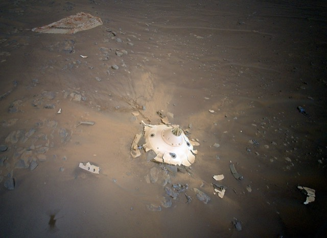
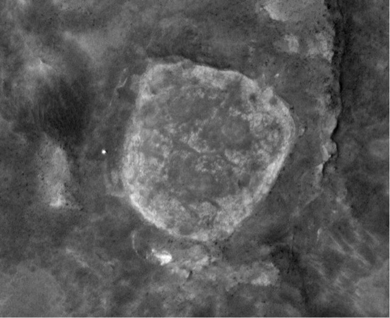

<div align="center">

<h1>Bedrock to Redrock</h1>
<p><strong>From building worlds to exploring new ones.</strong></p>
<p>A Minecraft-inspired approach to exploring Mars.</p>

<a href="https://www.spaceappschallenge.org/2026/find-a-team/bedrock-to-redrock/">NASA Space Apps 2026 · Team page</a>

</div>

---

## The idea

**Bedrock to Redrock** draws on Minecraft's sense of discovery and survival to make navigation on Mars interactive, accessible, and engaging.

Our aim is to bring Mars science data into a clear, layered map that helps human explorers understand their surroundings and plan a Marswalk.

## The challenge

Created for **NASA Space Apps Challenge 2026** at the **Irbid, Jordan** local event, the project addresses **Interplanetary Survival Guide: Martian Map**.

Future astronauts will need more than a route from one point to another. They will need terrain information, conditions along the way, and scientific context to explore safely and make the most of each mission.

The project is working toward:

- **A layered Mars map** combining information from multiple NASA science missions.
- **Route planning** that helps explorers assess their path and destination.
- **An accessible exploration experience** inspired by Minecraft's spirit of discovery.

## The app

Explore Mars, compare modeled routes, and open the detailed terrain packs at Wildcat Ridge and Mount Sharp.

- A flat world map and 3D globe with a Viking colour basemap, NASA Trek layers, and MOLA elevation.
- Mapped mission records with **Read about** and **Go to location**. See the [catalog counts by source](docs/research/catalog-counts.md).

- Terrain-aware walking and rover time estimates, indicated MOLA resolution for regional routes, and optional return routes.
- Interactive terrain at Wildcat Ridge and lower Mount Sharp with geology, science flags, and custom simulated walks.
- Earth GPS simulation on supported phones and tablets, plus recorded navigation previews.

```sh
npm ci
npm run dev        # http://localhost:5173 (intro), #/explore, #/map, #/bench
npm test
```

See [running, testing and deploying](docs/release/RUNNING.md) and the [app architecture](docs/architecture/marswalk-app.md).
Research on the challenge and its resources is in [docs/research](docs/research/).

## Discovery images

### Perseverance parks at Wildcat Ridge


Credit NASA/JPL-Caltech.

### Berry Hollow abrasion at Wildcat Ridge


Credit NASA/JPL-Caltech.

### Sample 12: Hazeltop


Credit NASA/JPL-Caltech/ASU/MSSS.

### Sample 13: Bearwallow


Credit NASA/JPL-Caltech/ASU/MSSS.

### Three Forks sample depot


Credit NASA/JPL-Caltech.

### Perseverance backshell and parachute imaged by Ingenuity



Credit NASA/JPL-Caltech.

### Curiosity cracks open pure sulfur in Gediz Vallis channel


Credit NASA/JPL-Caltech/MSSS.

### Spirit's last position at Troy



Credit NASA/JPL-Caltech/University of Arizona.

## Project workflow

See the [coordination guide](docs/coordination.md) for team assignments and review.
The [final preview checklist](docs/release/FINAL-MOBILE-CHECKLIST.md) records release verification.

Follow the project on our [official team page](https://www.spaceappschallenge.org/2026/find-a-team/bedrock-to-redrock/).
