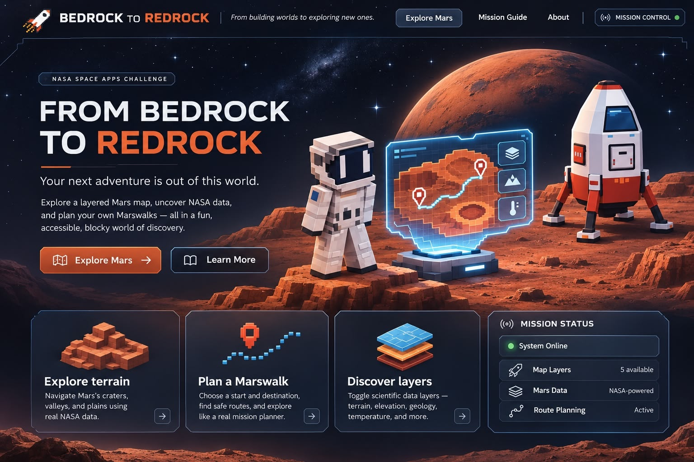

# Bedrock to Redrock — UI design prompt for Alia

Use this image as the visual reference for the Bedrock to Redrock homepage. Match its composition, color balance, lighting, and asset style closely. Apply the same visual system to the app’s existing map controls and panels. Keep the current copy, navigation, and functionality in place. Keep this pass focused on UI styling and artwork.

## Visual direction

- Use deep space navy behind warm, rusty Mars terrain. Pair recognizable Minecraft-inspired block shapes with restrained mission-control details such as hairline blue borders, clipped corners, and small cyan accents.
- Render Mars itself with realistic craters, shadows, and a warm rim light. Use chunky voxel geometry for the astronaut, rocket, and foreground rocks. Light them from the same direction so the scene feels continuous.
- Use cyan glow around the hologram and small active controls. Reserve bright orange for the primary action and the **Redrock** portion of the heading. Use green sparingly for genuine status indicators.

## Palette

- **Space backdrop** `#080D19` and **header** `#0C1220`.
- **Panel surface** `#151E2E` and **raised surface** `#202D42`.
- **Primary text** `#F3F6FC` and **muted text** `#B6C3D6`.
- **Cool border** `#526B88` and **cyan highlight** `#6BD6FF`.
- **Mars orange** `#F36B37`, **primary button base** `#A94424`, and **terrain shadow** `#56251E`.
- **Online green** `#73D47D`. Pair color with a readable status label wherever the app displays a real status.

## Layout and type

- **Header.** Use a compact dark strip with a pixel rocket and two-tone wordmark on the left. Place existing navigation on the right. Use a thin blue edge and an outlined active item.
- **Hero.** Use a wide landscape composition. Keep roughly the left two-fifths quiet for the live HTML heading, body text, and buttons. Place the planet high on the right. Arrange the astronaut near the middle, the holographic map just to its right, and the rocket on the far right. Let the rocky foreground extend under both sides.
- **Typography.** Use a heavy, wide sans-serif such as **Archivo Black** for the large uppercase hero and **Inter** for navigation, body text, panels, and controls. Confine any pixel font to the intro wordmark or a small accent. Keep the text group left-aligned and the paragraph width narrow enough to read over the scene.
- **Buttons.** Use the screenshot’s clipped-corner silhouette. Make the primary action a copper-orange fill with white text and icon. Give the secondary action a dark surface and cool outline. Use visible focus and selected states.
- **Lower row.** Use the screenshot’s three illustrated cards and wider status-panel silhouette as a layout reference for existing content. Give cards a translucent navy surface, thin blue border, shallow clipped corners, and generous space for the illustration. Populate status rows from information the app already exposes.
- **Responsive layout.** Keep the desktop split. On tablets, let the artwork crop toward its center and wrap the cards. On narrow phones, place the headline and primary action first, then the artwork and stacked cards. Reposition or simplify background detail to keep the text readable.

## Assets

- **Hero background.** Prepare a wide star field and Mars landscape with a large upper-right planet, a dark left edge behind the text, and an orange rock shelf along the bottom.
- **Astronaut.** Use a blocky figure with an off-white suit, square dark visor, subtle blue accents, and boots. Leave enough clear space around the silhouette to work over the terrain and at mobile sizes.
- **Rocket.** Use the team-supplied model where available. Match the reference’s white upper body, burnt-orange lower panels, dark window, and angular landing legs in the hero render.
- **Holographic map.** Create a cyan-edged glass panel on a low pedestal. Use an orange stepped terrain inset, two white pins, and a thin cyan route. Keep it as decorative hero art so the actual map remains the interactive surface.
- **Feature illustrations.** Make a stepped orange rock formation, an orange pin with a dotted cyan path, and stacked blue-and-orange map sheets. Render them at a consistent angle and lighting with transparent backgrounds.
- **Icon system.** Use pixel art for the small brand rocket and block accents. Use simple line icons for navigation, buttons, and panel controls. Match the team’s Bedrock and rocket markers to the same color and lighting system.
- Export optimized raster art for the hero and transparent artwork where separate positioning helps. Build the text, buttons, cards, and status rows as live UI elements. Use the supplied screenshot as the design reference and keep it in the prompt package.

## Visual acceptance

- [ ] Desktop composition matches the reference’s left text block, large Mars, astronaut, cyan hologram, right-hand rocket, and lower card row.
- [ ] Tablet and phone layouts keep the primary action easy to reach and the text readable without horizontal scrolling.
- [ ] Artwork, typography, outlines, and button states feel consistent across the intro and existing app panels.
- [ ] Capture the updated homepage at desktop and phone widths for side-by-side review with the reference.

## Implementation notes

**Assets.** All artwork is original SVG drawn in code (`src/components/HeroArt.tsx`), which scales without separate raster exports:
- star field, planet with craters and rim light;
- stepped voxel rock shelf, holographic map;
- pixel rocket fallback and brand rocket;
- three feature illustrations.

**Rocket and astronaut.** The hero rocket is the team-supplied model (`src/assets/models/redrock-lander.glb`), rendered once as a still with the same upper-right key light (`src/components/HeroRocket3D.tsx`). It falls back to the pixel rocket without WebGL. The astronaut was restyled with an off-white suit, a dark square visor and blue accents.

**Type and palette.**
- Fonts: Archivo Black for the hero and wordmark, Inter for everything else (both SIL OFL). The pixel font has been removed.
- The palette tokens are in `src/styles/app.css`.
- Buttons use a clipped-corner outline with an inset focus ring, applied to the intro and to the existing map controls and panels.

**Copy and behaviour.** Copy, navigation and functionality are unchanged. The status panel shows only values the app loads: catalog count, layer count and data load state.

**Review captures.**
- `docs/evidence/home-desktop-1536.jpg`.
- `docs/evidence/home-phone-390-tablet-820.jpg`, captured with headless Chrome in iframes at those widths.
